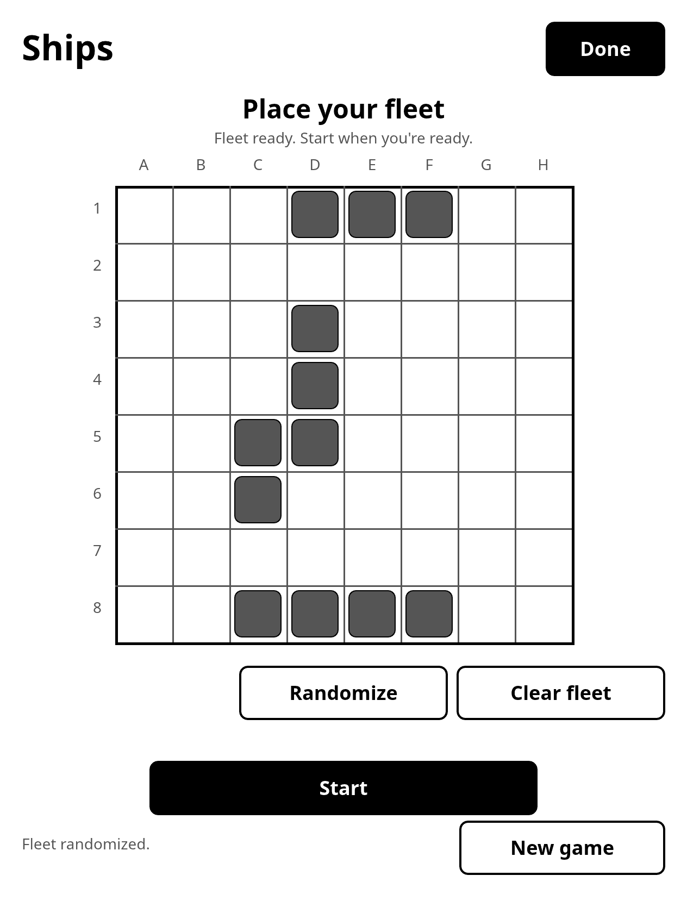

<div align="center">

# Ships

**A fleet game for one or two**

[](https://github.com/PrimitiveOS/kindle-primitive-ships/actions/workflows/ci.yml)
[](https://github.com/PrimitiveOS/kindle-primitive-ships/releases)
[](https://github.com/PrimitiveOS/kindle-primitive-ships/tags)
[](LICENSE)
[](https://github.com/PrimitiveOS/kindle-primitive-ships/stargazers)
[](https://primitiveos.github.io/kindle-primitive-catalog/v1/index.json)

[**Download**](https://github.com/PrimitiveOS/kindle-primitive-ships/releases/latest) · [**Install guide**](INSTALL.md) · [**Changelog**](CHANGELOG.md)

</div>

---

Place your fleet by hand or shuffle it into position. Find the other ships on an eight-by-eight map, against the Kindle at three levels or with a second player.

## Quick start

After setting up PrimitiveOS, open **Store** from Primitive Launcher. Choose **Ships** under **Apps**,
tap **Get**, and open it from the Launcher grid. The [install guide](INSTALL.md) also covers the standalone USB package.

## Screenshots

<table>
<tr>
<td align="center"><br><sub>Place your fleet</sub></td>
<td align="center"><br><sub>Take a shot in dark mode</sub></td>
<td align="center"><br><sub>Hand off between turns</sub></td>
</tr>
</table>

<sub>Mac simulation captures at 1264 × 1680 pixels.</sub>

## Highlights

- **Flexible placement.** Place and turn ships yourself or generate a fleet with **Random**.
- **Three difficulty levels.** Easy chooses a random square, Standard pursues nearby hits, and Hard weighs possible ship positions.
- **Two-player handoff.** A handoff screen covers both maps between turns. The app saves the game so you can resume.

## Develop locally

Keep `doannt-kindle-tools` and `doannt-kindle-launcher` beside this checkout, then run the following from this repo.

```sh
cargo test --offline --locked --workspace
cargo run --offline --locked -p ships-desktop
```

The desktop target writes previews to `build/previews/`. The desktop simulation exercises fleet placement, targeting, and the two-player handoff.
On an ARMHF Kindle Oasis 3 running firmware 5.18.2, Ships opened the mode selector, started an Easy solo game,
switched fleet placement from Across to Down and back, and returned to Launcher. See the [device
notes](docs/device-notes.md) for the verification checklist.

## Status

| Device | Status |
|---|---|
| Kindle Oasis 3 (1264 × 1680, firmware 5.18.2) | Tested on hardware |

**Current version: 0.1.1.** Changes are in [CHANGELOG.md](CHANGELOG.md).

## Downloads

The badge at the top shows the number of Store downloads. It counts GitHub downloads of this app's release packages, across all versions and architectures, and is refreshed daily from the [Store catalog](https://primitiveos.github.io/kindle-primitive-catalog/v1/index.json).

## Documentation

[Install guide](INSTALL.md) · [Changelog](CHANGELOG.md) · [Device notes](docs/device-notes.md)

## Licence

Copyright (C) 2026 Doan Nguyen.

Code is licensed under [PolyForm Noncommercial 1.0.0](LICENSE). The original documentation and pictures are licensed under [CC BY-NC-SA 4.0](LICENSE-DOCS).
