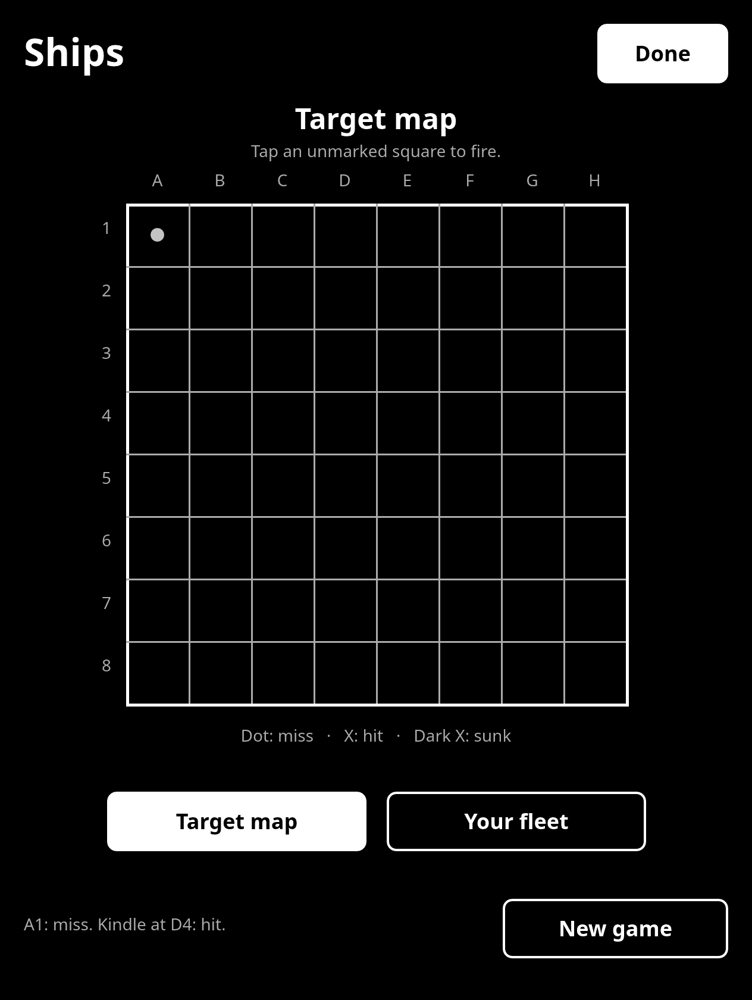
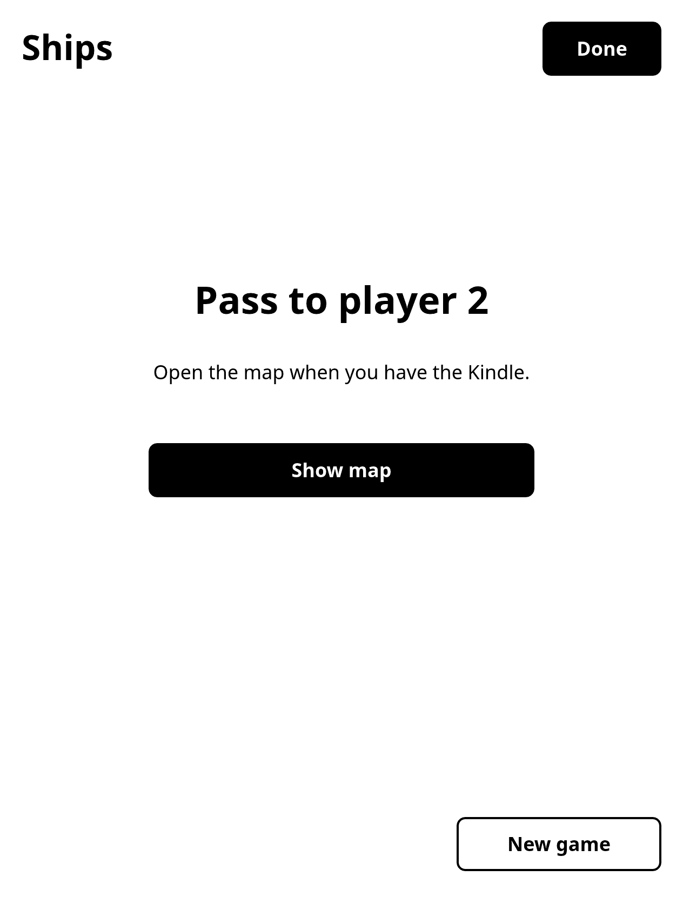

<div align="center">

# Ships

**Find the opposing fleet on an eight-by-eight map.**

[**Install guide**](INSTALL.md) · [**Device notes**](docs/device-notes.md) · [**Changelog**](CHANGELOG.md)

</div>

---

Set out four ships and take turns looking for the opposing fleet. Play against the Kindle at one of three difficulty levels or hand the same device to another player between turns.

## Screenshots

<table>
<tr>
<td align="center"><br><sub>Place your fleet</sub></td>
<td align="center"><br><sub>Take a shot in dark mode</sub></td>
<td align="center"><br><sub>Hand off between turns</sub></td>
</tr>
</table>

<sub>Mac simulation captures at 1264 × 1680 pixels.</sub>

## Highlights

- **Flexible placement.** Place and turn ships yourself or generate a fleet with **Random**.
- **Three difficulty levels.** Easy chooses a random square, Standard pursues nearby hits, and Hard weighs possible ship positions.
- **Two-player handoff.** A handoff screen covers both maps between turns. The app saves the game so you can resume.

## Quick start

1. Find the local ARMHF package and USB installation steps in the [install guide](INSTALL.md).
2. Extract the package, copy the `ships` and `documents` folders to your jailbroken Kindle’s user storage, and eject it.
3. Open Ships from Primitive Launcher. **Done** returns to the launcher grid.

The local `app.json` is a listing draft. A public listing requires approved artwork and an asset from a published release.

## Develop locally

Keep `doannt-kindle-tools` and `doannt-kindle-launcher` beside this checkout, then run the following from this repo.

```sh
cargo test --offline --locked --workspace
cargo run --offline --locked -p ships-desktop
```

The desktop target writes previews to `build/previews/`. The desktop simulation exercises fleet placement, targeting, and the two-player handoff.
On an ARMHF Kindle Oasis 3 running firmware 5.18.2, Ships opened the mode selector, started an Easy solo game,
switched fleet placement from Across to Down and back, and returned to Launcher. See the [device
notes](docs/device-notes.md) for the verification checklist.

## Licence

Copyright (C) 2026 Doan Nguyen.

Code is licensed under [PolyForm Noncommercial 1.0.0](LICENSE). The original documentation and pictures are licensed under [CC BY-NC-SA 4.0](LICENSE-DOCS).
